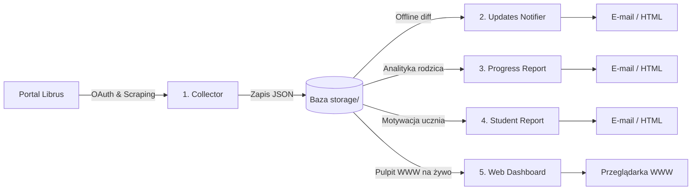

<div align="center">

# 📬 Librus2mail

**Nowoczesny, bezobsługowy asystent szkolny rodzica i analityk postępów nauki dziecka dla e-dziennika Librus Synergia**

[](https://github.com/cackoarek/librus2mail/actions/workflows/ci.yml)
[](https://www.python.org/)
[](https://github.com/astral-sh/ruff)
[-success.svg?style=flat-square&logo=pytest&logoColor=white)](tests/)
[](pyproject.toml)
[](src/librus2mail/web/)
[](docs/deployment.md#1-konteneryzacja-docker--docker-compose)
[](docs/deployment.md#2-usługi-systemowe-systemd-linux--raspberry-pi)
[](src/librus2mail/templates/emails/)
[](LICENSE)
[](https://cackoarek.github.io/librus2mail/)

<p align="center">
  Automatyczne powiadomienia e-mail o ocenach, wiadomościach i ogłoszeniach szkolnych<br>
  oraz interaktywny pulpit WWW z planem lekcji na żywo, frekwencją, symulatorem ocen i raportami motywacyjnymi.
</p>

<p align="center">
  
</p>

[🚀 Szybki start](#-szybki-start-w-3-krokach) • [🌐 Przeglądaj Demo](#-przykładowe-raporty-i-widoki-www-na-żywo) • [🏛️ Moduły](#-architektura-i-5-modułów-systemu) • [📚 Kompletna dokumentacja](#-kompletna-dokumentacja)

</div>

---

## 💡 Dlaczego Librus2mail?

Oficjalny portal e-dziennika Librus bywa niewygodny, wymaga ciągłego ręcznego logowania, a powiadomienia mobilne bywają ograniczone płatnymi subskrypcjami. **Librus2mail** rozwiązuje te problemy w elegancki sposób:

* 🔔 **Bieżące powiadomienia e-mail bez opóźnień**: Otrzymuj estetyczne podsumowania nowych ocen, ogłoszeń i wiadomości bezpośrednio na swój telefon w skrzynce Gmail lub dowolnej skrzynce IMAP/SMTP.
* 🌐 **Interaktywny Panel WWW Rodzica**: Lekki dashboard (Flask + TailwindCSS + HTMX) działający w domowej sieci: plan lekcji z zastępstwami i trwającą lekcją na żywo, analiza frekwencji (heatmapa i kalendarz z selektorem), terminarz sprawdzianów i 4 motywy wizualne (Nord, Emerald, Dark, Classic).
* 🎯 **Symulator ocen "Co jeśli...?" i prognoza czerwonego paska**: Przeliczanie średnich ważonych, wskaźniki formy PoP, badanie progu świadectwa z wyróżnieniem i dynamiczna prognoza wpływu nowej oceny na średnią.
* 🎮 **Motywacyjne raporty dla ucznia**: 3 warianty wiekowe (Kids dla klas 4–6 z odznakami i Supermocami, Teens dla klas 7–8 z celem E8, Youth dla szkół średnich z KPI).
* 👨‍👩‍👧‍👦 **Wsparcie dla wielu dzieci (Multi-account)**: Monitorowanie wielu profili uczniów w jednej instancji z osobnymi regułami powiadomień.
* 🛡️ **100% Prywatności i bezpieczeństwa**: Żadne dane uczniów, loginy ani oceny nie opuszczają Twojego komputera ani nie trafiają do obcych chmur. Całość działa lokalnie (`Local-First`), a panel WWW zabezpiecza bramka Parent Gate i ochrona przed atakami brute-force.

---

## 📄 Przykładowe raporty i widoki WWW (na żywo)

Możesz przetestować wygenerowane raporty i widoki aplikacji bezpośrednio w przeglądarce bez instalacji:

| Kategoria | Widok / Raport | Opis funkcjonalności | Link demo |
|:---|:---|:---|:---|
| 🌐 **Pulpit WWW** | **Pulpit rodzica (Dashboard)** | Główne KPI, trwająca lekcja, kalendarium i alerty | [→ Zobacz](https://cackoarek.github.io/librus2mail/latest/web_dashboard.html) |
| 📅 **Pulpit WWW** | **Plan lekcji na żywo** | Tygodniowy rozkład zajęć, zastępstwa, sale i aktualna lekcja | [→ Zobacz](https://cackoarek.github.io/librus2mail/latest/web_plan.html) |
| 📊 **Pulpit WWW** | **Frekwencja** | Heatmapa roczna, kalendarz miesięczny z selektorem i statystyki | [→ Zobacz](https://cackoarek.github.io/librus2mail/latest/web_frekwencja.html) |
| 🎯 **Pulpit WWW** | **Oceny i Symulator "Co jeśli?"** | Wagi ocen, wykluczanie przedmiotów ze średniej, kalkulator | [→ Zobacz](https://cackoarek.github.io/librus2mail/latest/web_oceny.html) |
| 🧙 **Pulpit WWW** | **Kreator instalacji (/setup)** | 4-krokowy onboarding w przeglądarce z testem połączenia | [→ Zobacz](https://cackoarek.github.io/librus2mail/latest/web_setup.html) |
| 📬 **E-mail** | **Powiadomienie bieżące** | Zbiorczy e-mail o nowych ocenach, ogłoszeniach i wiadomościach | [→ Zobacz](https://cackoarek.github.io/librus2mail/latest/powiadomienie_collector.html) |
| 📈 **E-mail** | **Raport postępów rodzica** | Średnie ważone, wskaźniki formy PoP, diagnoza stylu nauki | [→ Zobacz](https://cackoarek.github.io/librus2mail/latest/raport_8979296.html) |
| 🎮 **E-mail** | **Raport ucznia: Kids (klasy 4–6)** | Grywalizacja, Supermoce, odznaki i motywujący język | [→ Zobacz](https://cackoarek.github.io/librus2mail/latest/raport_kids.html) |
| 🚀 **E-mail** | **Raport ucznia: Teens (klasy 7–8)** | Egzamin 8-klasisty, bilans postępów, szybkie szanse na awans | [→ Zobacz](https://cackoarek.github.io/librus2mail/latest/raport_teens.html) |
| 🎯 **E-mail** | **Raport ucznia: Youth (liceum/technikum)**| Strategiczny dashboard KPI, średnie semestralne i cele | [→ Zobacz](https://cackoarek.github.io/librus2mail/latest/raport_youth.html) |

---

## 🏛️ Architektura i 5 modułów systemu

Projekt zaprojektowano modułowo wg filozofii **UNIX (jeden moduł = jedno zadanie)**. Moduły mogą być uruchamiane niezależnie lub w zintegrowanym potoku:



1. **Moduł 1: Collector (`librus_collector.py`)** – bezpieczna autoryzacja OAuth, pobieranie surowych danych z portalu Librus Synergia (z opóźnieniami rate-limiting i rotacją User-Agent) oraz aktualizacja lokalnej bazy `storage/`.
2. **Moduł 2: Updates Notifier (`librus_updates_notifier.py`)** – 100% offline; porównuje bieżący stan bazy ze znacznikami czasu i wysyła przejrzyste powiadomienia e-mail (HTML) o nowościach.
3. **Moduł 3: Progress Report (`librus_progress_report.py`)** – analityczny raport okresowy dla rodziców: średnie ważone, wskaźniki PoP, badanie warunków czerwonego paska i diagnoza stylu uczenia się.
4. **Moduł 4: Student Report (`librus_student_report.py`)** – motywacyjny raport dla ucznia z odznakami, celami i językiem dostosowanym do wieku (Kids, Teens, Youth).
5. **Moduł 5: Web Dashboard (`librus_web.py`)** – interaktywny pulpit WWW (Flask + TailwindCSS) z planem lekcji na żywo, frekwencją, symulatorem ocen, terminarzem, centrum akcji CLI i kreatorem `/setup`.
6. **Orkiestrator (`librus_collect_and_notify.py`)** – centralna fasada CLI łącząca moduły w automatyczny potok demona w tle (`Collector -> Notifier -> Sleep`) lub wywołująca wybrane moduły w odosobnieniu.

> 📖 **Szczegółowy opis działania każdego modułu znajdziesz w dokumencie [docs/modules.md](docs/modules.md)**.

---

## 🚀 Szybki start w 3 krokach

### Krok 1: Klonowanie i przygotowanie środowiska
```bash
git clone https://github.com/cackoarek/librus2mail.git
cd librus2mail

python3 -m venv venv
source venv/bin/activate
pip install -r requirements.txt
```

### Krok 2: Konfiguracja (w przeglądarce lub pliku YAML)
Możesz skonfigurować aplikację na dwa sposoby:

* **Wariant A (Najprostszy – Kreator WWW)**:
  Uruchom panel webowy:
  ```bash
  python librus_web.py
  ```
  Otwórz w przeglądarce adres `http://localhost:5000` — aplikacja automatycznie uruchomi 4-krokowy kreator konfiguracji (`/setup`), sprawdzi połączenie z kontem Librus i zapisze plik `config.yaml`.

* **Wariant B (Tradycyjny – Plik YAML)**:
  Skopiuj gotowy szablon i uzupełnij swoje dane:
  ```bash
  cp config-example.yaml config.yaml
  nano config.yaml  # wpisz login/hasło do Librusa i dane serwera poczty
  ```

### Krok 3: Uruchomienie monitoringu

Jeśli używasz nakładki web z kroku 2, to monitoring włączy się automatycznie po skonfigurowaniu. Jeśli nie (bo np. nie chcesz używać interfejsu www, a tylko dostawać maile z raportami), możesz uruchomić monitoring w tradycyjny sposób:

```bash
# Uruchomienie ciągłego demona monitorującego:
python librus_collect_and_notify.py

# Lub jednorazowe sprawdzenie (np. pod harmonogram cron):
python librus_collect_and_notify.py --once
```

---

## 📚 Kompletna dokumentacja

Szczegółowe podręczniki, specyfikacje i instrukcje wdrożeniowe zostały podzielone tematycznie w katalogu `docs/`:

| Przewodnik | Zawartość i tematyka |
|:---|:---|
| 🏛️ **[docs/modules.md](docs/modules.md)** | Szczegółowa specyfikacja wszystkich 5 modułów, architektura, przepływ danych i flagi CLI. |
| ⚙️ **[docs/configuration.md](docs/configuration.md)** | Pełny opis pliku `config.yaml`, zmienne środowiskowe, konfiguracja Gmail (App Password), SMTP, frekwencja i bezpieczeństwo. |
| 🛠️ **[docs/useful-scripts.md](docs/useful-scripts.md)** | Podręcznik CLI: wszystkie przełączniki, symulacje offline, generowanie raportów HTML i testy w terminalu. |
| 🐳 **[docs/deployment.md](docs/deployment.md)** | Wdrożenie produkcyjne: Docker & Docker Compose, usługi `systemd` (Linux/Raspberry Pi), reguły `cron` i reverse proxy Nginx. |
| 📐 **[docs/architecture.md](docs/architecture.md)** | Architektura systemu, zasada Local-First, format bazy danych `storage/`, modele Pydantic i bezpieczeństwo sesji. |
| 💻 **[docs/development.md](docs/development.md)** | Przewodnik dla programistów: środowisko testowe `pytest`, linter `ruff`, generowanie raportów demo i procedura wydawania wersji. |
| ❓ **[docs/faq-and-troubleshooting.md](docs/faq-and-troubleshooting.md)** | Najczęstsze pytania, diagnoza błędów (`NotLogged`, błędy SMTP), polityka oznaczania wiadomości jako przeczytane i bezpieczeństwo konta. |

---

## 🐳 Wdrożenie Docker i systemd (w pigułce)

### Kontener Docker
```bash
# Uruchomienie usługi w tle:
docker compose -f docker/docker-compose.yml up -d --build

# Podgląd logów kolektora:
docker compose -f docker/docker-compose.yml logs -f collector
```

### Usługa systemowa systemd (Linux / Raspberry Pi)
```bash
# Instalacja jednostki i start:
sudo cp deploy/systemd/librus2mail.service /etc/systemd/system/
sudo systemctl daemon-reload
sudo systemctl enable --now librus2mail

# Podgląd statusu i logów:
sudo systemctl status librus2mail
sudo journalctl -u librus2mail -f
```
> Więcej opcji wdrożenia znajdziesz w **[docs/deployment.md](docs/deployment.md)**.

---

## 🛡️ Bezpieczeństwo i prywatność

1. **Przetwarzanie lokalne**: Dane ze szkoły są pobierane bezpośrednio z serwerów Librusa i zapisywane wyłącznie na dysku lokalnym Twojej maszyny w katalogu `storage/`.
2. **Ochrona haseł**: Hasła do kont Librus oraz serwera e-mail znajdują się w pliku `config.yaml` (zabezpieczonym w `.gitignore`) lub zmiennych środowiskowych.
3. **Parent Gate i ochrona przed atakami**: Panel webowy zabezpieczony jest hasłem rodzica, odporny na ataki brute-force (automatyczna blokada IP) oraz wyposażony w bezpieczne ciasteczka sesyjne (`SameSite=Lax`, ochrona proxy).
4. **Ochrona przed banem portalu**: Pobieranie danych z portalu Librus zawiera sztuczne opóźnienia (`sleep(5)`) oraz rotację nagłówków `User-Agent`, aby nie obciążać serwerów szkolnych.

---

## 📜 Licencja i podziękowania

Projekt jest udostępniony na licencji **[MIT](LICENSE)**.

Projekt powstał w oparciu o analizę mechanizmu komunikacji z API Librusa zawartą w projekcie [Mati365/librus-api](https://github.com/Mati365/librus-api/).

> **Nota prawna:** Librus2mail jest niezależnym, niekomercyjnym projektem edukacyjnym o otwartym kodzie źródłowym, niepowiązanym, nienadzorowanym ani nieautoryzowanym przez spółkę Librus Sp. z o.o. Znak towarowy „Librus” został użyty wyłącznie w celach informacyjnych w celu wskazania kompatybilności i interoperacyjności oprogramowania.
