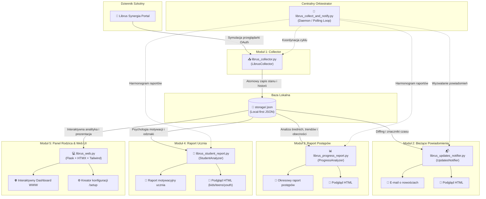

# 🧩 Szczegółowy opis modułów – Librus2mail

Projekt **Librus2mail** zbudowany jest w oparciu o architekturę 5 wyspecjalizowanych, luźno powiązanych modułów, którymi zarządza centralny orkiestrator. Każdy z modułów może pracować zarówno w ramach zintegrowanej usługi monitoringu w tle, jak i jako w pełni samodzielne narzędzie konsolowe (CLI).

---

## 🏛️ Schemat architektury modułowej

---

## 📥 Moduł 1: Kolektor danych i Scraping (`librus_collector.py`)

Kolektor odpowiada za bezpieczną komunikację z systemem Librus Synergia, emulację sesji przeglądarkowej rodzica, pobranie wszystkich kluczowych danych oraz ich strukturyzację w lokalnej bazie stanu `storage/`.

### 🔑 Kluczowe funkcje i mechanizmy:
1. **Emulacja przepływu OAuth 2.0**:
   - Wykonanie 4-etapowego handshaku uwierzytelniającego (pobranie formularza, wysłanie poświadczeń `login` i `pass`, obsługa ekranu pomijania 2FA, przejście przez bramkę Synergia `gateway`).
   - Przechowywanie ciasteczek sesyjnych w obrębie `requests.Session` z automatycznym odnawianiem sesji przy wygaśnięciu.
2. **Pobieranie i parsowanie sekcji dziennika**:
   - **Wiadomości (`/wiadomosci`)**: ekstrakcja nadawcy, daty, tematu oraz opcjonalnie treści wiadomości (`read_messages: true`).
   - **Ogłoszenia (`/ogloszenia`)**: komunikaty dyrekcji szkoły i ogłoszenia dla rodziców.
   - **Terminarz (`/terminarz`)**: zapowiedziane sprawdziany, kartkówki, zadania domowe i wydarzenia szkolne.
   - **Plan lekcji (`/plan_lekcji`)**: rozkład zajęć na cały tydzień z salami, nauczycielami, zastępstwami i lekcjami odwołanymi.
   - **Oceny (`/przegladaj_oceny/uczen`)**: pełna historia ocen bieżących z wagami, kategoriami, komentarzami oraz ocenami z zachowania.
   - **Frekwencja (`/przegladaj_nb/uczen`)**: szczegółowe wpisy obecności z podziałem na nieobecności nieusprawiedliwione (`nb`), usprawiedliwione (`u`), spóźnienia (`sp`) i zwolnienia (`zw`), statusem modułu e-Usprawiedliwień oraz oficjalnymi tabelami semestralnymi.
3. **Ochrona przed blokadą konta (Anti-Ban & Rate Limiting)**:
   - Dynamiczna rotacja nagłówków `User-Agent` (`fake_useragent`).
   - Wbudowane sztywne opóźnienia (`sleep(5)`) pomiędzy zapytaniami do kolejnych podstron dziennika, uniemożliwiające wywołanie alarmów antybotowych Librusa.
4. **Persystencja danych (Local-First Storage)**:
   - Zapis danych w czytelnym formacie JSON w katalogu `storage/<login>.json`.
   - Atomowy zapis z wykorzystaniem plików tymczasowych (`atomic write`), co chroni przed uszkodzeniem bazy w razie nagłego wyłączenia zasilania lub restartu kontenera.

---

## 📬 Moduł 2: Bieżące powiadomienia e-mail (`librus_updates_notifier.py`)

Moduł ten analizuje bazę stanu `storage/`, wykrywa nowe lub zmienione wpisy i przygotowuje zwięzłe, estetyczne podsumowanie wysyłane na adresy e-mail rodziców.

### 🔑 Kluczowe funkcje i mechanizmy:
1. **Mechanizm znaczników czasu (Watermarks)**:
   - Precyzyjne wykrywanie nowości na podstawie zestawów unikalnych identyfikatorów (`known_grades`, `known_messages`, `known_notifications`) oraz znacznika czasu ostatniego powiadomienia (`last_notify_time`).
   - **Automatyczny punkt bazowy (Baseline)**: przy pierwszym uruchomieniu system rejestruje obecny stan konta bez wysyłania lawiny historycznych powiadomień.
2. **Zawartość podsumowania e-mail (`templates/emails/summary.html`)**:
   - **Karty KPI**: podsumowanie liczbowe nowych ocen, wiadomości, ogłoszeń i frekwencji.
   - **Szczegółowe zestawienie ocen**: ocena z kolorową odznaką, przedmiot, waga, kategoria i komentarz nauczyciela.
   - **Plan lekcji na kolejny dzień nauki**: pełny harmonogram godzinowy najbliższego dnia szkolnego z oznaczonymi salami i uwzględnieniem zastępstw.
   - **Zdarzenia frekwencji**: odznaki symboli (`🔴 nb`, `🟢 u`, `🟡 sp`), numery lekcji, tematy zajęć i statusy e-Usprawiedliwień.
   - **Treści wiadomości i ogłoszeń**: podgląd nadawcy, tytułu i treści bez konieczności logowania się do Synergii.
3. **Tryby działania**:
   - Możliwość generowania podglądu w terminalu (`--dry-run`).
   - Eksport gotowego pliku HTML (`-o / --save-html`) do weryfikacji wyglądu bez wysyłania e-maila.
   - Praca w 100% offline w oparciu o wcześniej pobrane dane ze `storage/`.

---

## 📊 Moduł 3: Raport postępów dziecka (`librus_progress_report.py`)

Moduł dedykowany dla rodziców, służący do okresowego (np. cotygodniowego lub comiesięcznego) monitorowania rozwoju edukacyjnego dziecka.

### 🔑 Kluczowe możliwości analityczne:
1. **Średnie ważone i podział semestralny**:
   - Precyzyjna kalkulacja średnich ważonych z poszczególnych przedmiotów.
   - Obsługa daty podziału roku szkolnego (`semester_split_date`), umożliwiająca niezależną analizę ocen z Semestru I i Semestru II.
   - Konfigurowalny algorytm predykcji oceny rocznej (`all_year_weighted`, `semesters_average`, `progress_favored`).
2. **Wykrywanie trendów i dynamiki**:
   - Porównanie bieżących wyników z poprzednim okresem: identyfikacja przedmiotów ze wzrostem formy (↗) oraz spadkiem (↘).
   - Analiza stabilności ocen i regularności przygotowania ucznia.
3. **System alertów i wczesnego ostrzegania**:
   - Automatyczne wykrywanie zagrożeń ocenami niedostatecznymi (średnia poniżej 2.0 lub ostatnia ocena 1).
   - Ostrzeżenia o zbliżających się sprawdzianach i pracach klasowych w najbliższych 7–14 dniach.
4. **Bilans frekwencji**:
   - Podsumowanie obecności w badanym okresie: bilans godzin opuszczonych, liczba nieobecności usprawiedliwionych i nieusprawiedliwionych, spóźnienia.
   - Zestawienie tematów lekcji, na których uczeń był nieobecny, ułatwiające nadrobienie zaległości.
5. **Prezentacja e-mail (`templates/emails/progress_report.html`)**:
   - Kolorowe wykresy paskowe postępów.
   - Podsumowanie przedmiotów wyłączonych ze średniej na świadectwie (np. religia/etyka, wychowanie do życia w rodzinie).

---

## 🎯 Moduł 4: Raport motywacyjny dla ucznia (`librus_student_report.py`)

Moduł zaprojektowany z myślą o bezpośrednim odbiorcy – uczniu. Skupia się na psychologii pozytywnego wzmocnienia, budowaniu poczucia własnej skuteczności i wskazywaniu konkretnych szans rozwojowych zamiast wytykania błędów.

### 🔑 3 warianty wiekowe szablonów:
1. **Wariant `kids` (Klasy 1–4 szkoły podstawowej)**:
   - Elementy grywalizacji: punkty doświadczenia, wirtualne puchary i medale.
   - Sekcja **Supermoce**: wyróżnienie przedmiotów, w których dziecko jest mistrzem.
   - Ciepły, motywujący język dostosowany do najmłodszych, eliminujący stres związany z ocenami.
2. **Wariant `teens` (Klasy 5–8 szkoły podstawowej)**:
   - Czytelne zestawienie mocnych stron i obszarów z potencjałem na szybki awans.
   - Moduł **Szanse na wyższą ocenę**: kalkulacja, ile dobrych ocen brakuje do podniesienia oceny semestralnej/rocznej o stopień wyżej.
   - Motywacja zadaniowa przygotowująca do egzaminu ósmoklasisty.
3. **Wariant `youth` (Szkoły ponadpodstawowe: liceum, technikum, branżowa)**:
   - Nowoczesny, dojrzały, minimalistyczny design w stylu dashboardu analitycznego.
   - Wskaźniki stabilności ocen, zarządzanie czasem i priorytetami w kontekście matury i rekrutacji na studia.
   - Podsumowanie bilansu wysiłku i precyzyjny symulator średniej końcowej.

---

## 💻 Moduł 5: Interaktywny Panel Rodzica i Kreator (`librus_web.py`)

Nowoczesna aplikacja webowa napisana w mikroframeworku Flask, wzbogacona o interaktywność HTMX oraz responsywny interfejs TailwindCSS. Działa całkowicie lokalnie, oferując pełną kontrolę nad danymi ucznia.

### 🔑 Główne widoki i funkcjonalności:
1. **Pulpit główny (Dashboard)**:
   - Kafelki szybkiego dostępu (średnia ogólna, oceny, plan na dziś, frekwencja, sprawdziany).
   - **Kalendarium ostatnich dni**: interaktywna siatka dni szkolnych prezentująca zintegrowaną oś czasu (nowe oceny z wagami, wiadomości, zapowiedzi sprawdzianów oraz odznaczone zdarzenia nieobecności ze statusem e-Usprawiedliwień).
   - **Podsumowanie planu lekcji**: godziny zajęć, sale, nauczyciele oraz kolorowe oznaczenia absencji.
2. **Plan lekcji na żywo (`/plan`)**:
   - Widok pojedynczego dnia oraz widok całego tygodnia.
   - **Live Lesson Tracker**: automatyczne wykrywanie lekcji odbywającej się w tej chwili (`🟢 TRWA TERAZ`), pulsujący wskaźnik, licznik czasu do dzwonka (`⏱️ jeszcze X min`), wyeksponowany numer sali.
   - Banery przerw międzylekcyjnych informujące o czasie do kolejnego dzwonka (`☕ Trwa przerwa między lekcjami`).
   - Wyciszenie kontrastu lekcji minionych (`✓ Odbyła się`).
3. **Oceny, Świadectwo i Optymalizator (`/oceny`)**:
   - Zestawienie ocen bieżących i śródrocznych pogrupowane według przedmiotów.
   - **Symulator świadectwa z wyróżnieniem**: kalkulacja średniej ze świadectwa, weryfikacja progu 4.75 oraz wymogu oceny z zachowania (bardzo dobra lub wzorowa), z możliwością oznaczania przedmiotów nieujętych na świadectwie.
   - **Optymalizator celu edukacyjnego (What-If Calculator)**: narzędzie podpowiadające rodzicowi i uczniowi, z których przedmiotów najłatwiej podnieść średnią przy minimalnym nakładzie pracy.
   - **Szczegółowa analityka przedmiotu (`/oceny/<przedmiot>`)**: historia ocen, wagi, stabilność, wykresy rozkładu ocen.
4. **Moduł Frekwencji i Obecności (`/frekwencja`)**:
   - **Dwa tryby wizualizacji kalendarza**:
     - *Opcja 2 (domyślna)*: Roczna horyzontalna heatmapa w stylu GitHub (kompaktowy pasek tygodni IX–VI z etykietami miesięcy i kolorowymi kafelkami statusu).
     - *Opcja 1*: Przejrzysty kalendarz wybranego miesiąca z pigułkami nawigacyjnymi.
     - Przełącznik trybu umieszczony bezpośrednio na karcie z trwałym zapisem w konfiguracji.
   - **Karty KPI**: liczniki nieobecności nieusprawiedliwionych (z alertem o wymaganej reakcji), usprawiedliwionych, spóźnień i zwolnień.
   - **Oś czasu nieobecności**: chronologiczny rejestr absencji z odznakami symboli, nauczycielami, tematami i informacją o e-Usprawiedliwieniu.
5. **Terminarz i Wiadomości (`/terminarz`, `/wiadomosci`)**:
   - Sprawdziany, kartkówki i zadania domowe z podziałem na nadchodzące i minione.
   - Skrzynka odbiorcza wiadomości i ogłoszeń szkolnych z pełnym podglądem treści.
6. **Centrum Akcji (`/akcje`)**:
   - Graficzny interfejs umożliwiający wyzwalanie operacji konsolowych (synchronizacja z Librusem, wysyłka powiadomień, generowanie raportów) bezpośrednio z przeglądarki jednym kliknięciem.
7. **Kreator Pierwszego Uruchomienia (`/setup`) i Ustawienia (`/ustawienia`)**:
   - Przeglądarkowy wizard ułatwiający konfigurację kont Librusa, poczty i parametrów monitoringu bez ręcznej edycji plików YAML.
   - Weryfikacja poprawności loginu i hasła Librus w czasie rzeczywistym (`POST /api/test-librus`).
   - Zarządzanie kalendarium, archiwizacja minionych lat szkolnych, harmonogramy raportów.
8. **Silnik Wielu Skórek (Multi-Theme Engine)**:
   - 4 wbudowane motywy dopasowane do każdego oświetlenia:
     - ☀️ **Jasny (Domyślny)**: czysty, kontrastowy motyw dzienny.
     - 🌙 **Slate Dark (Ciemny Grafit)**: stonowany motyw ciemny redukujący zmęczenie oczu.
     - 🌌 **Midnight (OLED True Black)**: głęboka czerń idealna dla ekranów AMOLED/OLED w smartfonach.
     - 🌲 **Forest Green (Szmaragd)**: elegancki, naturalny motyw w tonacji leśnej zieleni.
     - 💻 **Tryb Auto**: automatyczne dopasowanie do preferencji systemowych użytkownika.
   - Skrypt pre-renderujący eliminujący efekt białego błysku (*Flash-of-White*) i pamięć wyboru w `localStorage`.
9. **Bezpieczeństwo Parent Gate**:
   - Ochrona dostępu hasłem z bezpiecznym hashowaniem PBKDF2.
   - Wbudowana ochrona przed atakami brute-force (blokada po 5 nieudanych próbach logowania).
   - Ochrona przed atakami CSRF (żetony w nagłówkach zapytań fetch i formularzy HTMX).
   - Bezpieczne ciasteczka sesyjne (`HttpOnly`, `SameSite=Lax`).

---

## 🚀 Centralny orkiestrator (`librus_collect_and_notify.py`)

Orkiestrator spaja wszystkie moduły w jedną niezawodną usługę działającą w nieskończonej pętli.

### 🔑 Zadania orkiestratora:
1. **Wykonywanie cyklu zbierania i powiadamiania**:
   - Autoryzacja i pobranie danych dla każdego konta skonfigurowanego w `librus_users`.
   - Zastosowanie opóźnień między kontami rodzeństwa, zapobiegających wykryciu scrapingu.
   - Sprawdzenie obecności nowych wpisów i natychmiastowe wygenerowanie powiadomienia e-mail przez `UpdatesNotifier`.
2. **Inteligentny harmonogram uśpienia (Smart Sleep)**:
   - Standardowe usypianie na czas `wait_time_s` (np. 15 minut).
   - Dynamiczne skracanie czasu uśpienia, gdy zbliża się zaplanowana godzina wysyłki okresowego Raportu Postępów lub Raportu Ucznia (zgodnie z harmonogramem `schedule` w `config.yaml`).
3. **Obsługa błędów i ciągłość pracy**:
   - Niezależne przechwytywanie błędów sieciowych i błędów sesji Librusa (ponawianie prób, logowanie zdarzeń).
   - Opcjonalne wysyłanie alertów e-mail do administratora w razie powtarzających się awarii logowania (`send_error_notifications: true`).
